# SOC-Copilot — SOC open-source augmenté par l'IA

> Mini-SOC complet, open-source et automatisé : détection, enrichissement par Threat Intelligence, analyse par IA locale et réponse à incident, de bout en bout.
>
> Projet de fin d'études (PFE) — Blue Team / SOC / Threat Intelligence.

     

---

## Architecture

<p align="center">
  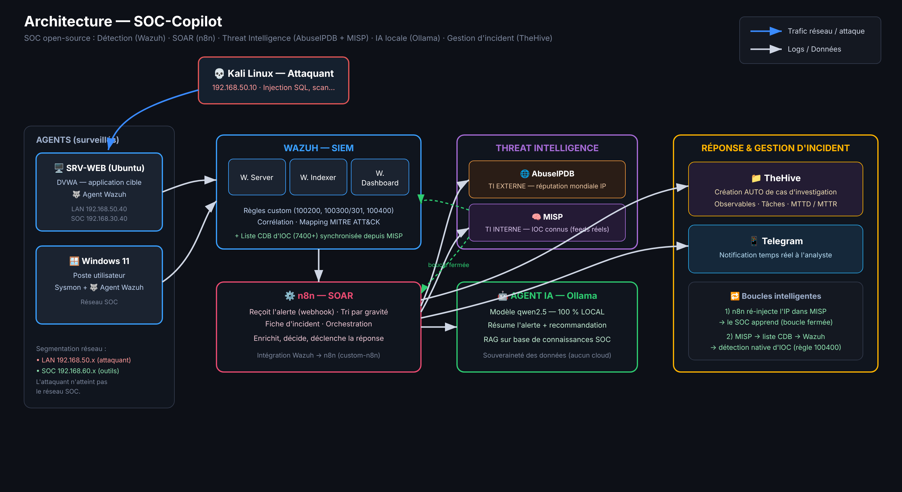
</p>

```
Kali (attaquant)
   | injection SQL / scan
   v
Agents Wazuh (SRV-WEB / DVWA, Windows 11 / Sysmon)
   | logs
   v
WAZUH SIEM -- detection (regles custom + correlation + MITRE)
   | alerte (niveau >= 10, via custom-n8n)
   v
n8n (SOAR) -- tri -> fiche -> orchestration
   |-- AbuseIPDB   (Threat Intel EXTERNE - reputation IP)
   |-- MISP        (Threat Intel INTERNE - IOC connu ?)
   |-- Agent IA    (Ollama, LOCAL - resume + recommandation)
   |-- Telegram    (notification analyste)
   \-- TheHive     (creation automatique de cas)

   n8n re-injecte l'IP dans MISP (boucle fermee : le SOC apprend)
   MISP -> liste CDB -> Wazuh (detection native d'IOC, regle 100400)
```

---

## Stack technique

| Composant | Outil | Rôle |
|-----------|-------|------|
| SIEM | Wazuh 4.x | Détection sur les logs, règles custom, corrélation |
| SOAR | n8n | Orchestration, tri, enrichissement, réponse automatisée |
| Threat Intel externe | AbuseIPDB | Réputation mondiale d'une IP |
| Threat Intel interne | MISP | Base d'IOC (feeds réels), partage de renseignement |
| Gestion d'incident | TheHive | Cas, observables, playbooks, métriques MTTD/MTTR |
| IA locale | Ollama (qwen2.5) | Triage et résumé d'alertes, 100 % local |
| Notification | Telegram | Alerte temps réel à l'analyste |
| Cible | DVWA (SRV-WEB) | Application web vulnérable |
| Attaquant | Kali Linux | Génération des attaques |

---

## Captures d'écran

### Détection — Wazuh SIEM

<table>
  <tr>
    <td width="50%" align="center"><b>Dashboard SOC</b><br>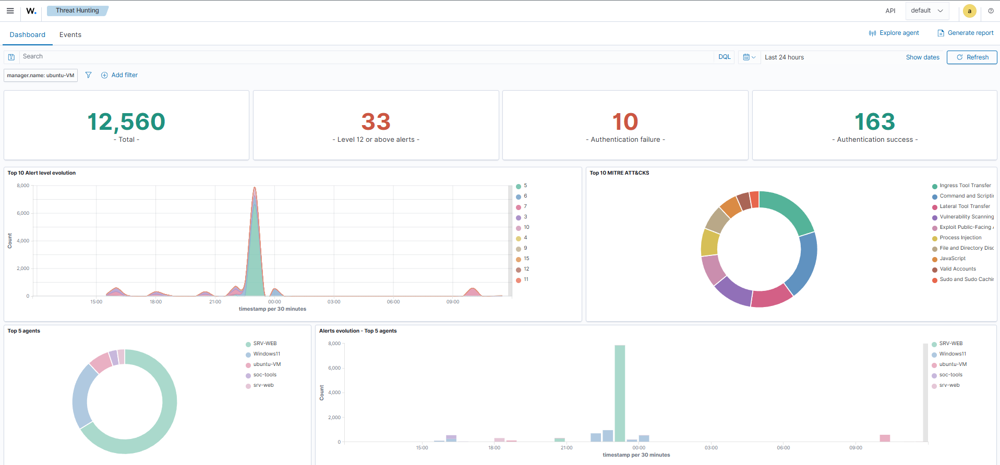</td>
    <td width="50%" align="center"><b>Détection d'injection SQL</b><br>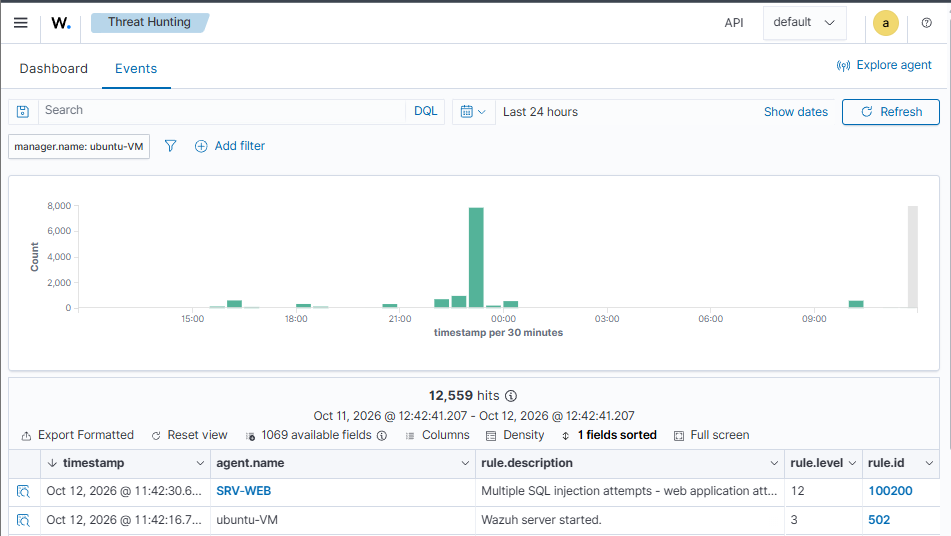</td>
  </tr>
  <tr>
    <td width="50%" align="center"><b>Alerte injection SQL (règle 100200 — T1190)</b><br>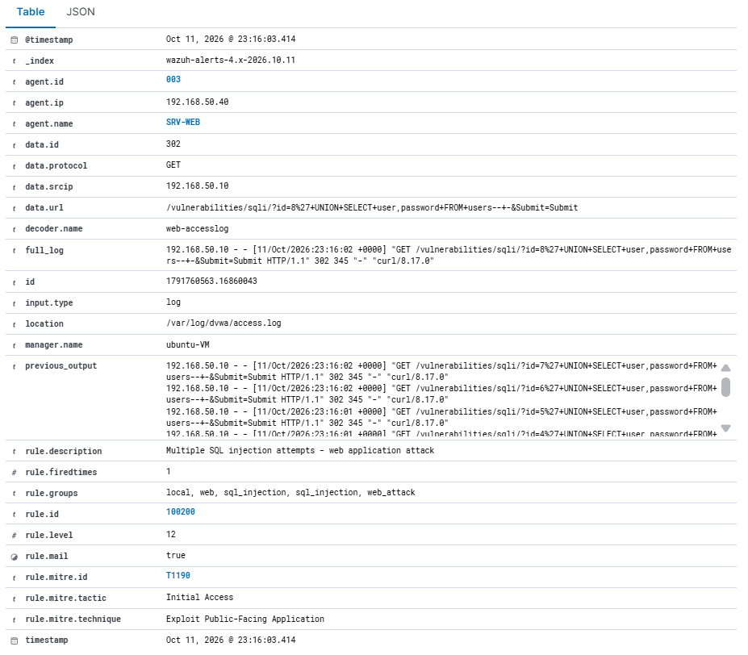</td>
    <td width="50%" align="center"><b>Définition de la règle personnalisée</b><br>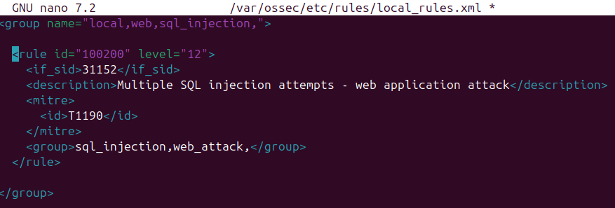</td>
  </tr>
  <tr>
    <td width="50%" align="center"><b>Détection de malware (T1204)</b><br>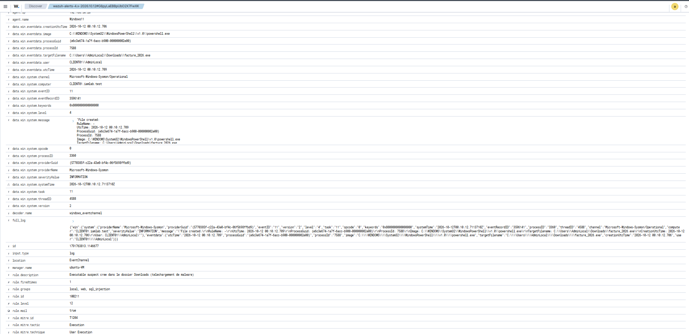</td>
    <td width="50%" align="center"><b>Brute force SSH (T1110)</b><br>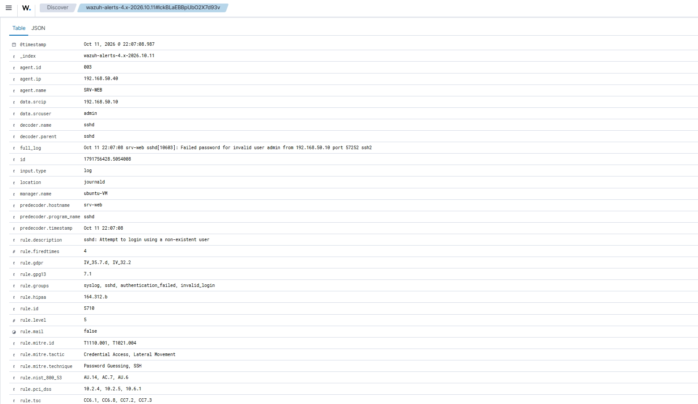</td>
  </tr>
</table>

### Orchestration & réponse

<table>
  <tr>
    <td width="50%" align="center"><b>Workflow SOAR (n8n)</b><br>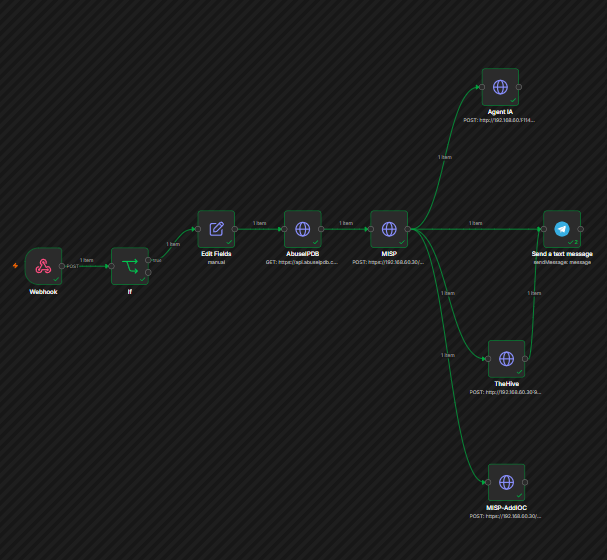</td>
    <td width="50%" align="center"><b>Alerte enrichie (Telegram)</b><br>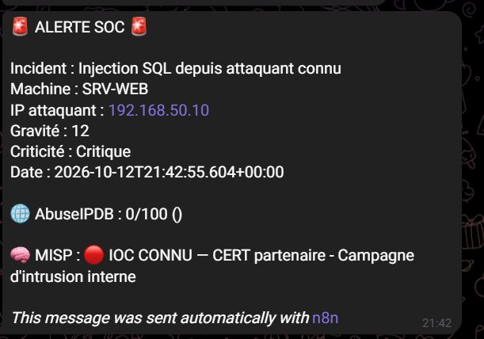</td>
  </tr>
  <tr>
    <td colspan="2" align="center"><b>Analyse par IA locale (Ollama)</b><br>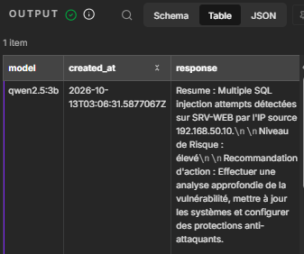</td>
  </tr>
</table>

### Threat Intelligence — MISP

<table>
  <tr>
    <td width="50%" align="center"><b>Dashboard MISP</b><br>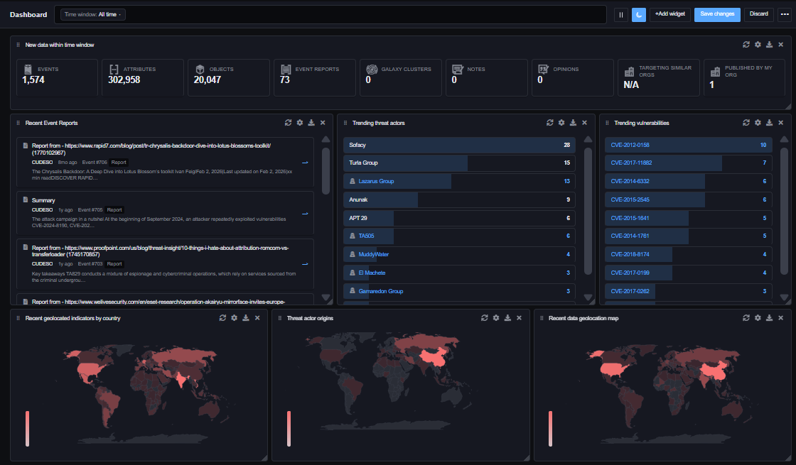</td>
    <td width="50%" align="center"><b>Indicateurs de compromission</b><br>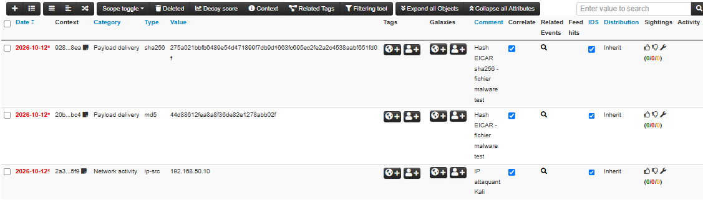</td>
  </tr>
  <tr>
    <td colspan="2" align="center"><b>Galaxies MITRE ATT&amp;CK</b><br>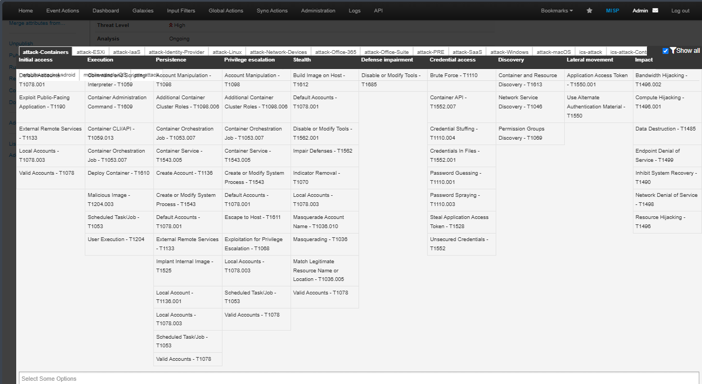</td>
  </tr>
</table>

### Gestion d'incident — TheHive

<table>
  <tr>
    <td width="50%" align="center"><b>Cas créé automatiquement</b><br>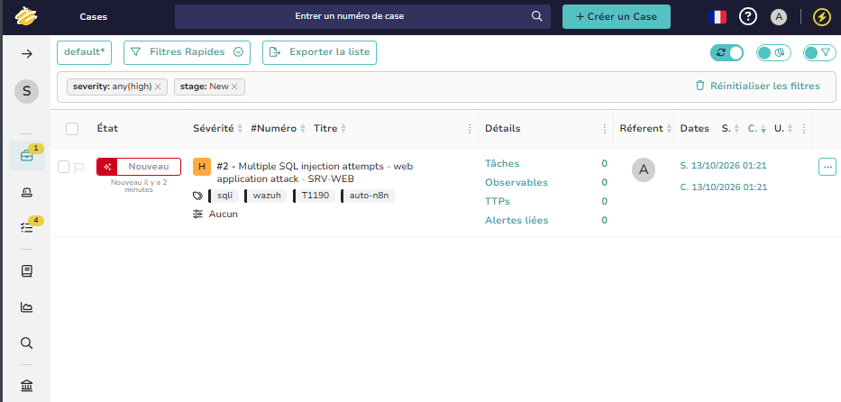</td>
    <td width="50%" align="center"><b>Observables</b><br>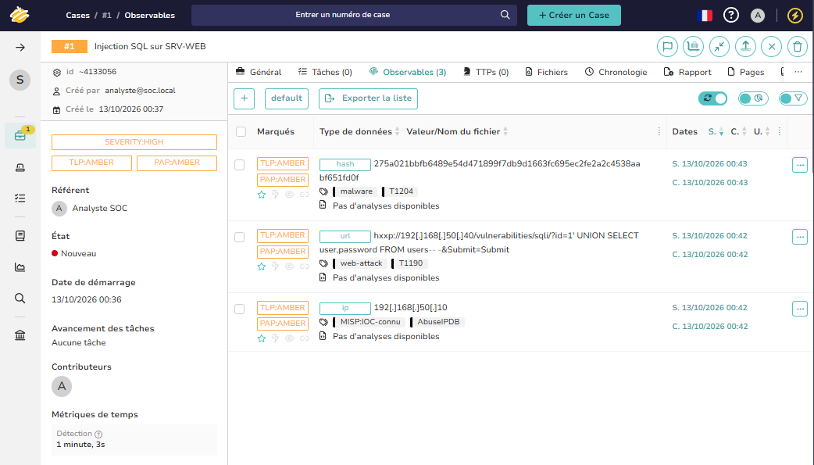</td>
  </tr>
  <tr>
    <td colspan="2" align="center"><b>Playbook / tâches de réponse</b><br>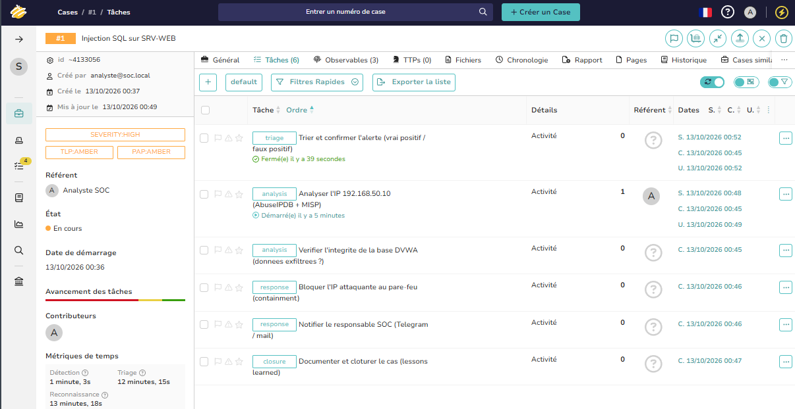</td>
  </tr>
</table>

---

## Cas d'usage de l'IA (Agent local)

- Triage automatique : l'IA résume l'alerte brute en langage clair et évalue le risque.
- Recommandation d'action : propose les prochaines étapes (bloquer, investiguer, clôturer).
- RAG : répond en s'appuyant sur la base de connaissances SOC du projet (playbooks, règles, MITRE).
- Souveraineté des données : aucune alerte n'est envoyée vers un cloud tiers, tout reste en local.

Prompts dans [`ai/prompts/`](ai/prompts/) · Base de connaissances RAG dans [`ai/knowledge-base/`](ai/knowledge-base/).

### Démonstration du RAG

L'IA locale répond aux questions de l'analyste **en s'appuyant sur les documents du projet** (playbooks, règles Wazuh, mapping MITRE, architecture — dossier [`ai/knowledge-base/`](ai/knowledge-base/)).

<table>
  <tr>
    <td width="50%" align="center"><b>Q : Quelles techniques MITRE le SOC couvre-t-il ?</b><br>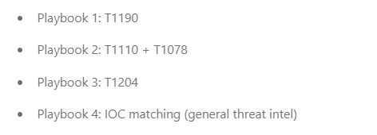</td>
    <td width="50%" align="center"><b>Q : Procédure face à une injection SQL ?</b><br>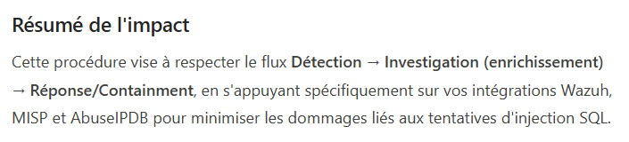</td>
  </tr>
</table>

Les réponses reprennent fidèlement le contenu des documents fournis — l'IA raisonne sur **le contexte du SOC**, pas sur des connaissances génériques.

---

## Couverture MITRE ATT&CK

| Tactique | Technique | Règle Wazuh |
|----------|-----------|-------------|
| Initial Access | T1190 — Exploit Public-Facing Application | 100200 |
| Credential Access | T1110 — Brute Force | 100300 |
| Defense Evasion | T1078 — Valid Accounts | 100301 |
| Execution | T1204 — User Execution | 100211 |
| Persistence | T1053.005 — Scheduled Task | Sysmon |
| Threat Intel match | IOC connu (MISP) | 100400 |

Détails : [`docs/mitre-mapping.md`](docs/mitre-mapping.md).

> Note : la règle par défaut de Wazuh classait l'injection SQL sous T1055 (Process Injection), un mapping erroné. La règle personnalisée 100200 corrige la classification vers T1190, élève la criticité (niveau 12) et enrichit la détection — une démarche de Detection Engineering.

---

## Démarrage rapide

### Prérequis
- VMware / VirtualBox, 3 VMs (Wazuh, SRV-WEB/DVWA, Windows 11) + Kali
- Docker & Docker Compose (pour MISP, TheHive, n8n)
- Ollama (sur l'hôte ou une machine dédiée)

### 1. Règles de détection Wazuh
```bash
sudo cp wazuh-config/custom-rules.xml /var/ossec/etc/rules/local_rules.xml
sudo systemctl restart wazuh-manager
```

### 2. Intégration Wazuh vers n8n
```bash
sudo cp scripts/custom-n8n /var/ossec/integrations/
sudo chmod 750 /var/ossec/integrations/custom-n8n
sudo chown root:wazuh /var/ossec/integrations/custom-n8n
# puis déclarer l'intégration dans ossec.conf (voir wazuh-config/README.md)
```

### 3. Import du workflow n8n
Importer le workflow dans n8n (Import from File), dossier [`n8n/`](n8n/).

### 4. Agent IA (Ollama)
```bash
ollama pull qwen2.5:3b
# exposer Ollama au réseau : OLLAMA_HOST=0.0.0.0
```

### 5. Synchronisation MISP vers Wazuh (liste CDB)
```bash
sudo cp scripts/sync-misp-iocs.sh /var/ossec/etc/lists/
sudo chmod +x /var/ossec/etc/lists/sync-misp-iocs.sh
# éditer le script : renseigner MISP_URL et MISP_KEY
sudo /var/ossec/etc/lists/sync-misp-iocs.sh
```
